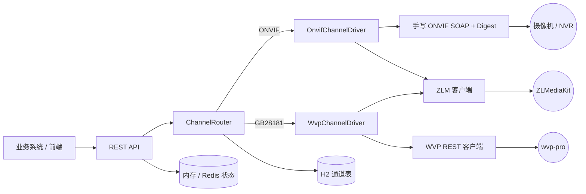

# video-bridge

把 ONVIF 摄像机和 GB28181（WVP）通道收进同一套 REST 接口的视频接入网关。

上层业务只需要认一个 `channelKey`，不用再关心这个通道是走 ONVIF 直连设备、还是走国标平台点流。实时预览、云台、预置位、录像、回放、下载、截图，两种协议返回同样的结构。

## 为什么做这个

ONVIF 和 GB28181 是两套完全不同的东西：前者是设备侧 SOAP 协议，要自己处理 Digest 认证、Profile、PTZ、回放 RTSP；后者是平台侧 REST，要管理 token、点流、国标录像。把它们混在业务系统里写，业务代码很快就会变成一堆 `if (protocol.equals("onvif"))`。

这个服务把协议差异关在 `ChannelDriver` 下面，业务侧只面对设备清单和统一 API。ONVIF 部分不依赖任何第三方 ONVIF 库，SOAP 报文和认证都是手写的，方便针对现场设备调；国标侧只调用 wvp-pro 的官方开放接口，不改动 wvp 本身。

## 功能

| 分类 | 能力 |
| --- | --- |
| 设备 | 通道增删改查（H2 文件库）、ONVIF 设备探测、海康 ISAPI 通道列表、WVP 设备/通道列表透传 |
| 实时预览 | 开始/停止点流、保活、播放地址（WebRTC / RTSP / WS-FLV / HTTP-FLV）、观看人数、截图 |
| 云台 | 方向/变焦/停止、预置位查询与设置/调用/删除、看守位（扩展版 wvp 可选） |
| 录像 | 手动录像启停与状态、云端/本地 MP4 录像列表、NVR 录像段检索、最长录制时长限制 |
| 回放下载 | 实时回放、录像下载、下载进度、暂停/恢复/倍速/跳转（国标）、定时自动关流 |
| 增强 | 永久存活流保活、多地址映射（API 地址与播放地址分离）、端点路径可配置、状态可切 Redis |

不含排班任务、告警联动、权限、操作日志这类业务功能——那是上层系统该做的事。

## 架构



`onvif` 包只管协议，`wvp` / `zlm` 包只管各自 HTTP 接口，`core` 负责按协议路由和编排，`api` 只做参数校验和响应包装。

## 快速开始

前置条件：

- JDK 21、Maven
- 一个可访问的 [wvp-GB28181-pro](https://github.com/648540858/wvp-GB28181-pro)（用国标通道时）
- 一个可访问的 [ZLMediaKit](https://github.com/ZLMediaKit/ZLMediaKit)（用 ONVIF 通道或播放国标流时必需）

```bash
git clone https://github.com/HongWuKeNaiHe/video-bridge.git
cd video-bridge
```

1. 改 `src/main/resources/application.yml`，填入自己的 WVP 和 ZLM 地址、账号、secret。仓库里全是占位值。

2. 启动：

```bash
mvn spring-boot:run
# 或者
mvn package && java -jar target/video-bridge-0.1.0.jar
```

服务默认监听 `8088`，H2 库文件写在 `./data/`，首次启动自动建表。

3. 注册一个 ONVIF 通道和一个国标通道：

```bash
curl -X POST http://localhost:8088/api/channels -H 'Content-Type: application/json' -d '{
  "channelKey": "gate-01",
  "name": "大门球机",
  "protocol": "onvif",
  "onvifHost": "10.0.0.64",
  "onvifPort": 80,
  "onvifUsername": "admin",
  "onvifPassword": "your-password",
  "nvrHost": "10.0.0.64",
  "channelNo": 1,
  "vendor": "AUTO",
  "permanent": false
}'

curl -X POST http://localhost:8088/api/channels -H 'Content-Type: application/json' -d '{
  "channelKey": "yard-01",
  "name": "堆场枪机",
  "protocol": "gb28181",
  "gbDeviceId": "34020000001320000001",
  "gbChannelId": "34020000001310000001"
}'
```

4. 点流，返回的播放地址两种协议结构一致：

```bash
curl -X POST 'http://localhost:8088/api/stream/start?channelKey=gate-01'
curl -X POST 'http://localhost:8088/api/stream/start?channelKey=yard-01'
```

接设备前建议先探一下：`POST /api/onvif/probe`，传 `host / port / username / password`，会返回设备名、Media Profile 和视频源，不写库。`GET /api/meta` 能看到默认端点路径和当前开关。

## 主要配置

| 配置 | 默认值 | 说明 |
| --- | --- | --- |
| `bridge.wvp.base-url` | `http://127.0.0.1:18978` | wvp 服务地址 |
| `bridge.wvp.username/password` | `admin` / 空 | 登录账号，密码按 MD5 传给 wvp |
| `bridge.wvp.share-zlm` | `true` | 共用 ZLM 时按 `play-host` 重算播放地址，不透传 wvp 返回的内网 IP |
| `bridge.wvp.fork-extensions` | `false` | 打开后才调用扩展版 wvp 的永久点播、看守位、批量截图 |
| `bridge.wvp.endpoints` | `{}` | 按 `WvpApi` 的键名覆盖任意端点路径，用来适配 wvp 版本差异 |
| `bridge.zlm.api-host/api-port` | `http://127.0.0.1` / `9098` | 网关访问 ZLM API 的地址 |
| `bridge.zlm.play-host/play-http-port/play-rtsp-port` | `127.0.0.1` / `8080` / `554` | 发给播放器的地址和端口，公网部署时和 api-host 分开配 |
| `bridge.zlm.secret/app/vhost` | 空 / `live` / `__defaultVhost__` | ZLM 鉴权与流应用名 |
| `bridge.onvif.request-timeout-ms` | `10000` | 设备请求超时 |
| `bridge.record.max-duration-seconds` | `900` | 单次手动录像上限 |
| `bridge.record.playback-pre-roll-seconds` | `4` | 国标回放起始时间前移量 |
| `bridge.state.type` | `memory` | `memory` 或 `redis`，后者需自行配置 `spring.data.redis.*` |
| `bridge.keep-alive.interval-seconds` | `60` | 永久流保活与残留录像流清理周期 |

## API

统一响应体：`{"code":0,"message":"ok","data":...}`，`code != 0` 表示业务失败。截图接口直接返回 `image/jpeg`。

| 方法 | 路径 | 说明 |
| --- | --- | --- |
| GET | `/api/channels` | 通道列表 |
| GET/DELETE | `/api/channels/{key}` | 查询 / 删除通道 |
| POST | `/api/channels` | 新增或按 `channelKey` 更新通道 |
| POST | `/api/stream/start?channelKey=` | 开始直播，返回播放地址 |
| POST | `/api/stream/stop?channelKey=` | 停止直播（永久流不关） |
| POST | `/api/stream/touch?channelKey=` | 立即保活一次 |
| GET | `/api/stream/status?channelKey=` | 在线状态、观看人数 |
| GET | `/api/stream/snap?channelKey=` | 截图 |
| POST | `/api/control/ptz` | 云台控制，body: `channelKey / command / speed` |
| GET | `/api/control/presets?channelKey=` | 预置位列表 |
| POST | `/api/control/preset` | 预置位操作，body: `channelKey / command(set,update,goto,remove) / presetToken / name` |
| POST | `/api/control/home-position` | 看守位（国标 + 扩展版 wvp） |
| POST | `/api/record/start?channelKey=` | 开始录像 |
| POST | `/api/record/stop?channelKey=` | 停止录像 |
| GET | `/api/record/status?channelKey=` | 录像状态与剩余时长 |
| GET | `/api/record/list?channelKey=&startTime=&endTime=` | 录像文件列表 |
| GET | `/api/record/nvr?channelKey=&startTime=&endTime=` | 海康 NVR 录像段检索 |
| POST | `/api/playback/start` | body: `channelKey / startTime / endTime / download` |
| POST | `/api/playback/stop?streamKey=` | 停止回放或下载 |
| GET | `/api/playback/progress?streamKey=` | 下载进度 |
| POST | `/api/playback/control` | 回放控制，body: `streamKey / type(pause,resume,speed,seek,stop) / seek / speed` |
| GET | `/api/playback/gb-records?channelKey=&startTime=&endTime=` | 国标设备录像查询 |
| GET | `/api/wvp/devices` | wvp 设备列表透传 |
| GET | `/api/wvp/channels` | wvp 通道列表透传 |
| POST | `/api/wvp/token/clear` | 清掉缓存的 wvp token |
| POST | `/api/onvif/probe` | 探测 ONVIF 设备 |
| POST | `/api/onvif/channels` | 海康 ISAPI 通道列表 |
| GET | `/api/meta` | 端点、协议、开关清单 |

时间统一用 `yyyy-MM-dd HH:mm:ss`。云台 `speed` 对外统一是 `0~1`，网关内部换算成国标 `1~255`。

## 现场踩过的坑，都写进实现里了

- **Digest 认证**：先发一次不带认证拿 `WWW-Authenticate`，算完 MD5 再重发。部分海康 NVR 未认证时返回的是 500 而不是 401，但头里带了完整校验参数，只看状态码会误判；只支持 Basic 的设备也做了回退。
- **HTTP 200 里的 SOAP Fault**：设备经常把错误放在成功响应的 Fault 节点里，所以每个响应都要检查，不能只看 HTTP 状态。
- **XML 命名空间**：各家前缀不一样（`tt:`、`trt:`、`tds:` 混用），按忽略前缀的标签名取值比按命名空间查询更耐受；SOAP 里的用户可控文本都做了 XML 转义。
- **回放地址**：标准 ReplayControl 在不少 NVR 上要么不支持、要么给的 URI 拉不通，实际主要靠厂商格式拼 RTSP 回放地址（海康 `/Streaming/tracks/`、大华 `/cam/playback`），标准接口作为兜底。
- **回放流不会自己停**：NVR 回放播完会从头循环，ZLM 等不到 EOF，下载模式只能按录像时长加余量定时关流，再确认文件落盘才标记完成。
- **截图地址**：`getSnap` 是 ZLM 自己按传入的 RTSP 去拉流截帧，必须用 ZLM 自身可达的地址；填成给浏览器用的公网地址只会拿到默认图。
- **播放地址里的内网 IP**：wvp 返回的流地址带的是 ZLM 内网 IP，`shareZlm=true` 时不用字符串替换，直接按 `play-host` 重新生成，避免把内网地址泄露给客户端。
- **保活**：wvp 2.7.x 的 `/api/v1/stream/touch` 是空实现，永久流靠 `auto_close=0` 加定时重新点播来兜，设备重启后能自动重拉。
- **国标回放开头缺几秒**：请求前把 `startTime` 往前挪几秒，吃掉 GOP/I 帧对齐的影响。
- **录像状态**：状态默认放内存并带 TTL，服务重启后定时任务丢失，靠定时扫描把残留录像流关掉；要多实例部署就把 `bridge.state.type` 切到 Redis。

## 版本与扩展接口

按 wvp-pro 2.7.x 官方接口开发，端点集中在 `WvpApi`，版本差异可以通过 `bridge.wvp.endpoints` 覆盖，不需要改代码。

首版**只依赖官方接口**。以下能力是某些 fork 版 wvp 才有的，默认关闭，把 `bridge.wvp.fork-extensions` 打开后才使用：

| 端点 | 用途 | 官方替代方案 |
| --- | --- | --- |
| `/api/play/startPersistent/{deviceId}/{channelId}` | 永久点播 | 定时重新点播保活 |
| `/api/device/control/home_position` | 看守位 | 暂无 |
| `/api/play/snap/batch` | 批量截图 | 逐通道调用 `/api/stream/snap` |

如果要让 fork 补丁单独成库发布，建议以 patch 文件附在发行说明里，不要把 wvp 源码合进本仓库——wvp-pro 是 MIT 许可，合并分发需要保留其版权声明。

## 开发

```bash
mvn test        # 33 个单元测试 + Spring 上下文启动
mvn package
```

包名是 `dev.videobridge`，跟仓库归属无关；fork 后想换成自己的命名空间，全局替换 package 和 import 即可。

```
src/main/java/dev/videobridge/
├── onvif/     SOAP 报文、Digest、XML 解析、厂商回放规则、海康 ISAPI
├── wvp/       wvp REST 客户端与端点表
├── zlm/       ZLM REST 客户端与播放地址
├── storage/   通道表、状态存储（内存 / Redis）
├── core/      协议路由、驱动、预览/控制/录像/回放服务
├── api/       REST 接口与请求对象
└── config/    配置模型
```

## 合规声明

本项目是独立实现，只用到公开的 ONVIF 规范、GB28181 生态的开放 REST 接口和 ZLMediaKit 的 HTTP API，不包含任何企业业务代码、内部地址、账号密钥或业务数据。仓库里所有地址与凭据都是占位值。使用者应自行确认设备接入、录像与转发行为符合所在网络的授权与数据合规要求。

## License

[MIT](LICENSE) · Copyright (c) 2026 HongWuKeNaiHe
